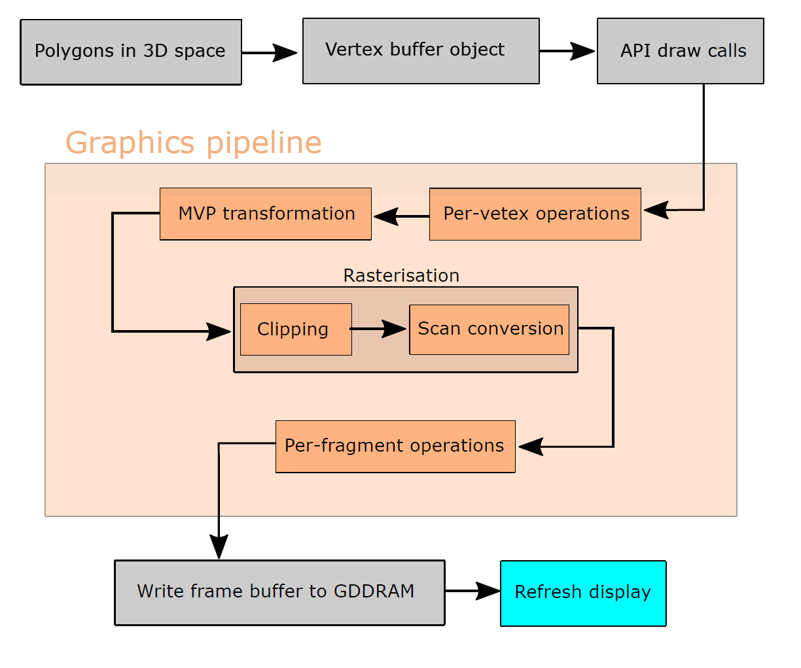
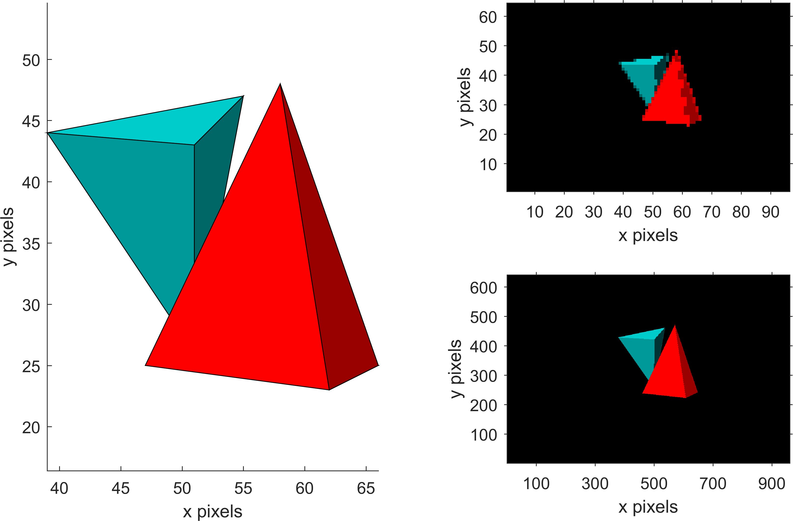

<h1 align="center">embedded-3d-rendering</h1>

<p align="center">
  <b>A 3D graphics pipeline for a microcontroller with 2 kB of RAM.</b><br>
  Vertex transform, scanline rasteriser and a depth test for every pixel, in one C file.<br>
  No GPU, no FPU and no frame buffer.
</p>

<p align="center">
  <a href="https://github.com/charlesnchr/embedded-3d-rendering/actions/workflows/build.yml"></a>
  <a href="LICENSE"></a>
  
  
  <a href="Reports/Charles%20Christensen%20-%20Final%20project.pdf"></a>
</p>

<p align="center">
  
</p>
<p align="center">
  <sub>The firmware from 2018, compiled as it is and run against a model of the display. <code>make run</code> plays this in your terminal.</sub>
</p>

One frame for this display takes 12,288 bytes. The microcontroller has 2,048 bytes of RAM. So the renderer never holds a frame. It works out one row of 96 pixels, sends those 192 bytes to the display over SPI and starts on the next row. A depth buffer would not fit either, so there is none. For every pixel the rasteriser computes the depth of each triangle that covers it, keeps the nearest and forgets the number.

I wrote this in 2018 for the Cambridge course 4B25, Embedded Systems for the Internet of Things. OpenGL ES assumes a GPU and far more memory than a small microcontroller has, and I wanted to know how much of that kind of pipeline fits on a Freedom KL03 board, a 48 MHz Cortex-M0+ with 32 kB of flash. Most of it does.

- **192 bytes of pixels.** The only pixels in RAM are the row being drawn. The full frame is in the display controller, which the firmware fills from the top down.
- **Depth test without a depth buffer.** Triangles that overlap come out right, at the cost of one interpolation per triangle per pixel.
- **784 bytes of stack for the whole renderer.** That covers the 8 triangles and their colours, two matrices, the edge table, the active edge list and the row buffer.
- **4 kB of code.** The firmware source compiles to 4,114 bytes of Thumb code at `-Os`. Software floating point from libgcc brings it to 17.5 kB.
- **One file to read.** [`rasterise.c`](rasterise.c) is 449 lines of C. The only hardware it touches is an SPI port and three GPIO pins.
- **Runs on a laptop.** `make` builds the same source against a model of the display, so you can watch it without the board. One desktop core renders more than 10,000 frames per second.
- **Measured on the board.** The KL03 draws the scene at 2.6 to 5.8 frames per second, depending on which stages are switched on.

## Try it

```bash
git clone https://github.com/charlesnchr/embedded-3d-rendering && cd embedded-3d-rendering
make
make run
```

You need a C compiler and make, nothing else. `make run` plays the turning model in the terminal until you press Ctrl-C. The terminal has to support 24-bit colour and be at least 96 columns wide.

`make gif` writes one full turn to `out/spin.gif`. For single frames, `build/firmware --ppm frame- --frames 36` writes `frame-000.ppm` to `frame-035.ppm`, and `build/firmware --help` lists the other options.

A complete graphics pipeline consists of the following steps:




Some simplifications have had to be made. The fragment shader, that is the per-fragment operations, that would normally be used to implement shading of lighting etc. has simply been impossible to fit into the implementation. 

The implementation currently renders the geometry below (images generated by identical MATLAB implementation):



## Repository layout
(1) The three reports related to the project are present in the `Reports` folder. Most importantly the final project report showing the results of the project. The project proposal and interim report contain more details on the project's subgoals. 

(2) Plots of results, diagram of pipeline and pictures of hardware setup are present in the folder `Figures`.

(3) The source code is in `Implementations/C` and a more platform-independent version stripped of SDK-specific calls is in the root folder, `rasterise.c`. There are a few versions of the implementation. A version without vertex shader based on pre-computed static vertices are in `Implementations/C/NoVert/i2c_comm_master.c`, and a version without Z depth testing is in `Implementations/C/NoZtest/i2c_comm_master.c`.

(4) A MATLAB implementation of the exact same pipeline, which was developed as a prototype before the embedded version, is in `Implementations/MATLAB/rasterise.m`. 
